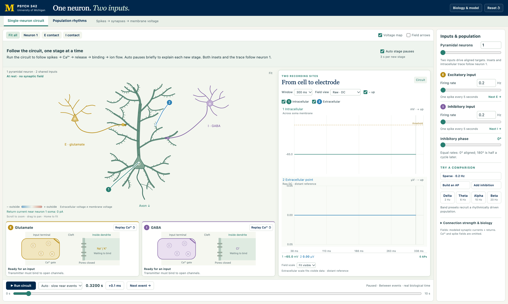

# Neuron to EEG: Neuron Circuits & Population Rhythms

An interactive, browser-based teaching simulator that follows the chain from a single presynaptic spike to a signal at the scalp. Students watch an action potential trigger calcium entry, transmitter release, receptor binding, and ion flow in a pyramidal neuron, then see how those synaptic currents sum across a population into extracellular fields, rhythms, and EEG.

It features a Zero-Dependency architecture, contained entirely within a single HTML file for easy sharing and offline use.

## Run Demo at https://dbrang.github.io/Neuron-to-EEG-Demo/

## 🎯 Purpose

EEG is recorded far from the neurons that generate it. This tool connects the two ends of that chain and helps students understand:

* **Synaptic transmission:** Action potential → terminal Ca²⁺ entry → transmitter release → receptor binding → channel opening → membrane response.
* **Synaptic integration:** How EPSPs overlap to reach threshold, and how GABA conductance can suppress excitation through shunting even without a substantial hyperpolarization.
* **Intracellular vs. extracellular signals:** Why a large membrane-voltage spike (mV) is not the same thing as a large extracellular or scalp signal (µV).
* **Population rhythms:** How coordinated synaptic currents across many pyramidal neurons, including an alpha-like rhythm that emerges from a recurrent excitatory–inhibitory network, produce oscillations in the local field and at the scalp.

## ✨ Key Features

* **Single-neuron circuit tab:**
  * A three-compartment conductance-based neuron receiving one excitatory (glutamate) and one inhibitory (GABA) input, with close-up insets of each synapse.
  * **Auto playback** slows near each event and pauses briefly to explain each new stage; scrub the timeline, step by +0.1 ms, or jump to the next scheduled spike.
  * Guided presets: **Sparse · 0.2 Hz**, **Build an AP**, **Add inhibition**, and externally driven **Delta / Theta / Alpha / Beta** population presets.
* **Population rhythms tab:**
  * A recurrent network of 64 pyramidal cells and 16 interneurons with independent stochastic background input and no imposed oscillation.
  * Spike rasters for every simulated cell, plus comparisons: **Alpha-like**, **Uncoupled**, **More E drive**, **More inhibition**, and **New random trial**.
  * A four-sphere (brain / CSF / skull / scalp) head model computes the scalp EEG signal from the modeled currents.
* **Synchronized recordings:** Numbered probes in the drawing match recording rows that share one time axis: somatic membrane voltage (mV), a local extracellular point probe (µV), and, in the population tab, scalp EEG (µV).
* **Display options:** Raw/DC or EEG-style 0.5–40 Hz filtering, negative-up polarity, adjustable time window, fit-to-data or fixed µV scales, and a live extracellular voltage map.
* **Biology & model** panel with detailed interpretation, stated model limitations, and sources.

## 🚀 Quick Start

There is no build process, no `npm install`, and no server required.

1. **Open** the live demo above, or **download** `index.html`.
2. **Open** the file in any modern web browser (Chrome, Firefox, Safari, Edge). No network connection is needed.
3. **Press Run circuit** and follow the stage explanations, then try the presets under **Try a comparison**.

No settings or student information are collected or saved.

## 🎓 Suggested Classroom Sequence

1. **Sparse · 0.2 Hz:** Follow one excitatory and one inhibitory input through every stage of synaptic transmission.
2. **Set the inhibitory rate to zero:** Compare the inward Na⁺ and outward K⁺ arrows. Both ions are positive, but more positive charge enters overall, depolarizing the dendrite.
3. **Build an AP:** EPSPs overlap until the soma reaches −50 mV. Electrode 1 shows the action potential in mV.
4. **Add inhibition:** Adjust rate, phase, connection strengths, and GABA reversal to explore shunting inhibition.
5. **Alpha:** Recruit 2,048 pyramidal neurons with coordinated 10 Hz input-rate modulation and watch the summed, waxing-and-waning extracellular signal. No sine wave is added directly to a recording channel.
6. **Population rhythms tab:** Compare the recurrent **Alpha-like** network with **Uncoupled**, **More E drive**, and **More inhibition** to see which settings change or abolish the rhythm.

## 🛠️ Technical Details

* **Stack:** Vanilla JavaScript, HTML5 Canvas.
* **Dependencies:** None.
* **Membrane model:** Three-compartment (two passive dendrites + soma) conductance-based integrate-and-fire neuron. Synaptic conductances use normalized differences of exponentials (E rise/decay 1/12 ms, I 1.5/20 ms). A −50 mV somatic threshold, reset, and 3 ms refractory interval. Explicit Euler integration at 0.1 ms with exact exponential synaptic-state decay.
* **Extracellular field:** Point-source summation in a homogeneous conductor (σ = 0.3 S/m), with each synaptic current paired with an equal and opposite return current near the soma.
* **Recurrent network:** Sparse E/I connectivity (p = 0.3) with 3 ms synaptic delays and spike-frequency adaptation in pyramidal cells. With the default seed, the network produces a ~9.75 Hz peak; this is a measured result, not a target.
* **Scalp EEG:** Concentric four-sphere head model (radii 78/80/86/92 mm; conductivities 0.3/1.79/0.01/0.43 S/m) solved by spherical-harmonic expansion, as instantaneous quasistatic volume conduction with no arbitrary amplitude multiplier.

### Scope

This is a teaching model, **not a calibrated human EEG forward solution**. The recurrent network is one illustrative mechanism, not an established unique generator of human alpha. Amplitudes are illustrative predictions, not fits to human recordings. The field calculations include pyramidal synaptic currents and their returns but omit spike, presynaptic calcium, and interneuron fields. Thalamus, cortical folding, active dendrites, NMDA/GABA-B currents, and plasticity are not modeled. Full details are in the in-app **Biology & model** panel.

## 📚 Scientific Context

* [Gerstner et al.: conductance-based input](https://neuronaldynamics.epfl.ch/online/Ch13.S6.html) and [compartmental models](https://neuronaldynamics.epfl.ch/online/Ch3.S4.html)
* [Purves et al.: ionic concentration/electrical forces](https://www.ncbi.nlm.nih.gov/books/NBK11054/), [summation](https://www.ncbi.nlm.nih.gov/books/NBK11104/), and [calcium-triggered release](https://www.ncbi.nlm.nih.gov/books/NBK11125/)
* [Buzsáki et al.: origins of extracellular fields](https://www.nature.com/articles/nrn3241)
* [Delgado et al. (2010): synaptic background conductance](https://pubmed.ncbi.nlm.nih.gov/21106811/)
* [Lőrincz et al. (2009): phasic inhibition and alpha spike timing](https://pubmed.ncbi.nlm.nih.gov/19755110/)
* [Haegens et al. (2011): alpha phase and neuronal spiking](https://pubmed.ncbi.nlm.nih.gov/22084106/)
* [Halgren et al. (2019): human cortical and thalamic alpha](https://pmc.ncbi.nlm.nih.gov/articles/PMC6876194/)
* [Næss et al. (2017): corrected four-sphere EEG model](https://pmc.ncbi.nlm.nih.gov/articles/PMC5651266/)
* [American Epilepsy Society atlas: normal EEG rhythms](https://www.ncbi.nlm.nih.gov/books/NBK390343/)
* [Schaworonkow: alpha waveform shape and harmonics](https://pmc.ncbi.nlm.nih.gov/articles/PMC12007518/)

## 📄 License

Distributed under the MIT License. See `LICENSE` for more information.

---

**Developed for Psych 342: Research Methods in Human Electroencephalography, University of Michigan.**
